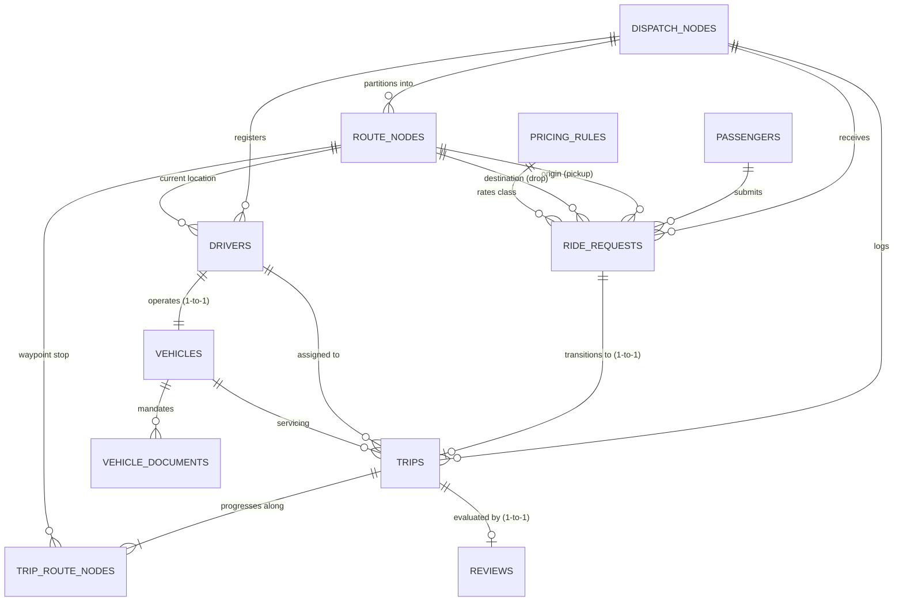

# 🚖 Ride Registry — DBMS PBL

[](https://www.mysql.com/)
[](https://flask.palletsprojects.com/)
[](#relational-normalization--design-rationale)
[](#stored-procedure-sp_match_ride)
[](LICENSE)

> **A robust, decentralized local-dispatch registry with demand-aware dynamic pricing, strict multi-document vehicle eligibility checks, transactional ride matching, waypoint route tracking, and customer review aggregations.**

---

## 📋 Table of Contents
1. [Project Overview & Core Purpose](#-project-overview--core-purpose)
2. [Key System Features](#-key-system-features)
3. [Entity-Relationship (ER) Architecture](#-entity-relationship-er-architecture)
4. [Relational Schema & Entity Dictionary](#-relational-schema--entity-dictionary)
5. [Database Views, Procedures & Triggers](#-database-views-procedures--triggers)
6. [Dynamic Surge Pricing Algorithm](#-dynamic-surge-pricing-algorithm)
7. [Important DBMS Queries](#-important-dbms-queries)
8. [Application Architecture & UI Screens](#-application-architecture--ui-screens)
9. [Installation & Setup Guide](#-installation--setup-guide)
10. [Git Setup & Repository Push](#-git-setup--repository-push)
11. [Step-by-Step Live Demo Script](#-step-by-step-live-demo-script)
12. [DBMS Viva Voce & Academic Defense Guide](#-dbms-viva-voce--academic-defense-guide)

---

## 🎯 Project Overview & Core Purpose

Modern ride-hailing systems require high transactional consistency, auditability, and partition-tolerant local dispatching. **Ride Registry** is a classroom Project-Based Learning (DBMS PBL) application simulating an institutional dispatch network across local geographic clusters (dispatch nodes). 

Unlike naive CRUD applications, Ride Registry enforces **strict database-level business constraints**:
- **Decentralized Local Clusters:** Dispatch zones maintain their own localized driver pool and route network.
- **Strict Compliance Verification:** A driver cannot be matched unless their vehicle possesses both **unexpired, verified Registration (RC)** and **Insurance**.
- **Demand-Aware Dynamic Surge Pricing:** Fares dynamically scale according to real-time local supply-vs-demand ratios, and pricing components are permanently snapshotted into trip records for financial auditability.
- **Atomic Ride Matching:** Concurrently requested rides are locked and matched via a MySQL Stored Procedure with row-level locks (`FOR UPDATE`) to prevent race conditions and double-dispatch.
- **Relocating Route Network:** Completing a trip dynamically relocates the driver's current position to the trip's destination node.
- **Integrity Enforcement Trigger:** Reviews cannot be created for rides that have not concluded with a `COMPLETED` lifecycle status.

---

## ⚡ Key System Features

| Feature | DBMS Implementation Mechanism | Business Impact |
|---|---|---|
| **Fleet Eligibility Gate** | `v_eligible_driver_vehicles` + compound index `(document_type, verification_status, valid_until)` | Unverified or expired vehicles are filtered out of match algorithms. |
| **Atomic Dispatching** | `sp_match_ride` with `START TRANSACTION`, `FOR UPDATE`, and `SQLEXCEPTION` handlers | Guarantees zero double-booking under concurrent passenger requests. |
| **Immutable Fare Snapshots** | Snapshotted columns: `base_fare`, `per_km_rate`, `surge_multiplier`, `total_fare` in `trips` | Changes to `pricing_rules` will never alter past invoices or accounting records. |
| **Multi-Hop Route Sequences** | `trip_route_nodes` with composite key `(trip_id, sequence_no)` | Retains ordered waypoints (pickup, drops, waypoints) in 3NF. |
| **Stateful Driver Relocation** | Atomic update: `drivers.current_node_id = rr.drop_node_id` on completion | Simulates real physical transit across city route nodes. |
| **Review Integrity Trigger** | MySQL Trigger `trg_review_completed_trip` (`BEFORE INSERT ON reviews`) | Blocks review fraud at the database engine level (independent of UI). |
| **Decoupled Driver Ratings** | SQL View `v_driver_review_aggregates` (`ROUND(AVG(rating), 2)`) | Keeps ratings fresh without polluting the base `drivers` table with derived columns. |

---

## 📐 Entity-Relationship (ER) Architecture



### Relational Cardinality & Rules
1. **One-to-Many (`1 : N`)**:
   - `DISPATCH_NODES` → `ROUTE_NODES`, `DRIVERS`, `RIDE_REQUESTS`, `TRIPS`
   - `PASSENGERS` → `RIDE_REQUESTS`
   - `VEHICLES` → `VEHICLE_DOCUMENTS` (supports Registration, Insurance, Permit)
   - `TRIPS` → `TRIP_ROUTE_NODES` (ordered 1, 2, ... $n$)
2. **One-to-One (`1 : 1`)**:
   - `DRIVERS` ↔ `VEHICLES` (`vehicles.driver_id` is unique)
   - `RIDE_REQUESTS` ↔ `TRIPS` (`trips.request_id` is unique)
   - `TRIPS` ↔ `REVIEWS` (`reviews.trip_id` is unique)
3. **Compound Key**:
   - `TRIP_ROUTE_NODES`: Composite Primary Key `(trip_id, sequence_no)`.

---

## 🗄️ Relational Schema & Entity Dictionary

The schema contains **11 base tables** normalized to **3NF / BCNF**:

| Table Name | Primary Key | Key Foreign Keys | Purpose |
|---|---|---|---|
| **`dispatch_nodes`** | `dispatch_node_id` | — | Regional dispatch clusters (e.g., Central, West). |
| **`route_nodes`** | `route_node_id` | `dispatch_node_id` | Named physical intersections, metro stations, localities. |
| **`passengers`** | `passenger_id` | — | Passenger registry with verified contact details. |
| **`drivers`** | `driver_id` | `current_node_id`, `dispatch_node_id` | Driver status (`AVAILABLE`, `ON_TRIP`, `OFFLINE`). |
| **`vehicles`** | `vehicle_id` | `driver_id` (UNIQUE) | Vehicle category (`BIKE`, `AUTO`, `CAB`), registration plate, capacity. |
| **`vehicle_documents`** | `document_id` | `vehicle_id` | Compliance records (`REGISTRATION`, `INSURANCE`) with verification status and expiry date. |
| **`pricing_rules`** | `vehicle_type` | — | Base fare, per-kilometer rate, and minimum fare per category. |
| **`ride_requests`** | `request_id` | `passenger_id`, `pickup_node_id`, `drop_node_id`, `dispatch_node_id`, `vehicle_type` | Pending passenger ride orders awaiting dispatch matching. |
| **`trips`** | `trip_id` | `request_id` (UNIQUE), `driver_id`, `vehicle_id`, `dispatch_node_id` | Operational and financial trip record with snapshotted fare & surge. |
| **`trip_route_nodes`** | `(trip_id, sequence_no)` | `trip_id`, `route_node_id` | Ordered waypoints followed during trip execution. |
| **`reviews`** | `review_id` | `trip_id` (UNIQUE) | 1–5 star customer rating and optional comment. |

### Relational Normalization & Design Rationale
- **1NF**: All table columns are atomic; phone numbers, registration strings, and timestamps contain single discrete values.
- **2NF**: No partial functional dependencies. In `trip_route_nodes` (`trip_id, sequence_no`), attributes (`route_node_id`, `reached_at`) depend on the whole composite key.
- **3NF & BCNF**: No transitive dependencies. Driver aggregates (average rating, review count) are **not** stored on `drivers` to prevent update anomalies; they are dynamically computed via SQL views.
- **Audit Immutability Exception**: `trips` intentionally copies `base_fare`, `per_km_rate`, and `surge_multiplier`. In transactional databases, this deliberate snapshotting ensures past financial ledgers never shift when baseline business rates are updated.

---

## ⚙️ Database Views, Procedures & Triggers

### 1. Database Views (Decoupled Reporting)
- **`v_eligible_driver_vehicles`**: Filters active drivers whose vehicles have unexpired (`valid_until >= CURRENT_DATE()`), verified Registration and Insurance documents.
- **`v_trip_registry`**: Flattens passenger, driver, vehicle, origin, and destination joins for high-speed audit viewing.
- **`v_driver_review_aggregates`**: Aggregates `ROUND(COALESCE(AVG(rating), 0), 2)` and `COUNT(review_id)` grouped by driver.
- **`v_vehicle_document_status`**: Provides pivot flags (`registration_ok`, `insurance_ok`) per vehicle for dispatch intake.

### 2. Stored Procedure: `sp_match_ride`
Performs ACID-compliant, atomic driver assignment and fare computation:
```sql
DELIMITER $$
CREATE PROCEDURE sp_match_ride(IN p_request_id BIGINT UNSIGNED)
proc: BEGIN
    -- 1. Declare transactional local variables
    DECLARE v_request_status VARCHAR(20);
    DECLARE v_vehicle_type VARCHAR(20);
    DECLARE v_dispatch_node_id BIGINT UNSIGNED;
    DECLARE v_pickup_node_id BIGINT UNSIGNED;
    DECLARE v_drop_node_id BIGINT UNSIGNED;
    DECLARE v_distance DECIMAL(7,2);
    DECLARE v_available_count INT DEFAULT 0;
    DECLARE v_pending_count INT DEFAULT 0;
    DECLARE v_driver_id BIGINT UNSIGNED;
    DECLARE v_vehicle_id BIGINT UNSIGNED;
    DECLARE v_base_fare, v_rate, v_minimum_fare, v_surge, v_total DECIMAL(10,2);
    DECLARE v_trip_id BIGINT UNSIGNED;

    -- 2. Rollback handler for concurrency failures
    DECLARE EXIT HANDLER FOR SQLEXCEPTION
    BEGIN
        ROLLBACK;
        RESIGNAL;
    END;

    START TRANSACTION;

    -- 3. Lock request row for update
    SELECT request_status, vehicle_type, dispatch_node_id, pickup_node_id, drop_node_id, distance_estimate_km
      INTO v_request_status, v_vehicle_type, v_dispatch_node_id, v_pickup_node_id, v_drop_node_id, v_distance
      FROM ride_requests WHERE request_id = p_request_id FOR UPDATE;

    IF v_request_status <> 'PENDING' THEN
        SIGNAL SQLSTATE '45000' SET MESSAGE_TEXT = 'Only pending ride requests can be matched';
    END IF;

    -- 4. Check available verified drivers in zone
    SELECT COUNT(*) INTO v_available_count
    FROM v_eligible_driver_vehicles
    WHERE vehicle_type = v_vehicle_type AND dispatch_node_id = v_dispatch_node_id;

    IF v_available_count = 0 THEN
        SIGNAL SQLSTATE '45000' SET MESSAGE_TEXT = 'No eligible driver in this dispatch zone';
    END IF;

    -- 5. Calculate real-time surge multiplier
    SELECT COUNT(*) INTO v_pending_count
    FROM ride_requests
    WHERE request_status = 'PENDING' AND vehicle_type = v_vehicle_type AND dispatch_node_id = v_dispatch_node_id;

    SELECT base_fare, per_km_rate, minimum_fare INTO v_base_fare, v_rate, v_minimum_fare
    FROM pricing_rules WHERE vehicle_type = v_vehicle_type;

    SET v_surge = CASE
        WHEN v_pending_count >= (v_available_count * 2) THEN 2.00
        WHEN v_pending_count > v_available_count THEN 1.50
        WHEN v_pending_count * 2 >= v_available_count THEN 1.20
        ELSE 1.00
    END;
    SET v_total = GREATEST(ROUND((v_base_fare + (v_rate * v_distance)) * v_surge, 2), v_minimum_fare);

    -- 6. Lock and match closest eligible driver (prefer pickup node)
    SELECT d.driver_id, v.vehicle_id INTO v_driver_id, v_vehicle_id
    FROM drivers d JOIN vehicles v ON v.driver_id = d.driver_id
    WHERE d.driver_status = 'AVAILABLE'
      AND d.dispatch_node_id = v_dispatch_node_id
      AND v.vehicle_type = v_vehicle_type
      AND v.vehicle_status = 'ACTIVE'
      AND EXISTS (SELECT 1 FROM vehicle_documents vd WHERE vd.vehicle_id = v.vehicle_id AND vd.document_type = 'REGISTRATION' AND vd.verification_status = 'VERIFIED' AND vd.valid_until >= CURRENT_DATE())
      AND EXISTS (SELECT 1 FROM vehicle_documents vd WHERE vd.vehicle_id = v.vehicle_id AND vd.document_type = 'INSURANCE' AND vd.verification_status = 'VERIFIED' AND vd.valid_until >= CURRENT_DATE())
    ORDER BY (d.current_node_id = v_pickup_node_id) DESC, d.driver_id ASC
    LIMIT 1 FOR UPDATE;

    -- 7. Persist trip, route waypoints, update driver & request state
    INSERT INTO trips (request_id, driver_id, vehicle_id, dispatch_node_id, trip_status, distance_km, base_fare, per_km_rate, surge_multiplier, total_fare)
    VALUES (p_request_id, v_driver_id, v_vehicle_id, v_dispatch_node_id, 'ASSIGNED', v_distance, v_base_fare, v_rate, v_surge, v_total);
    SET v_trip_id = LAST_INSERT_ID();

    INSERT INTO trip_route_nodes (trip_id, sequence_no, route_node_id)
    VALUES (v_trip_id, 1, v_pickup_node_id), (v_trip_id, 2, v_drop_node_id);

    UPDATE ride_requests SET request_status = 'MATCHED' WHERE request_id = p_request_id;
    UPDATE drivers SET driver_status = 'ON_TRIP' WHERE driver_id = v_driver_id;

    COMMIT;
    SELECT v_trip_id AS trip_id, v_driver_id AS driver_id, v_vehicle_id AS vehicle_id, v_surge AS surge_multiplier, v_total AS total_fare;
END$$
DELIMITER ;
```

### 3. Business Rule Trigger: `trg_review_completed_trip`
Enforces lifecycle validity before allowing feedback records into the database:
```sql
DELIMITER $$
CREATE TRIGGER trg_review_completed_trip
BEFORE INSERT ON reviews
FOR EACH ROW
BEGIN
    IF NOT EXISTS (
        SELECT 1 FROM trips t
        WHERE t.trip_id = NEW.trip_id AND t.trip_status = 'COMPLETED'
    ) THEN
        SIGNAL SQLSTATE '45000' SET MESSAGE_TEXT = 'Only completed trips can be reviewed';
    END IF;
END$$
DELIMITER ;
```

---

## 📈 Dynamic Surge Pricing Algorithm

The fare computation incorporates local vehicle category rates and real-time market demand:

$$\text{Final Fare} = \max\Big(\text{minimum\_fare},\, \big(\text{base\_fare} + \text{distance\_km} \times \text{per\_km\_rate}\big) \times \text{surge\_multiplier}\Big)$$

| Market Demand Ratio | Surge Multiplier | Condition |
|---|---|---|
| **Severe Deficit** | **$\times 2.00$** | $N_{\text{pending}} \ge 2 \times N_{\text{available}}$ |
| **High Demand** | **$\times 1.50$** | $N_{\text{pending}} > N_{\text{available}}$ |
| **Elevated Demand** | **$\times 1.20$** | $2 \times N_{\text{pending}} \ge N_{\text{available}}$ |
| **Equilibrium / Surplus** | **$\times 1.00$** | Standard baseline rates |

---

## 🔍 Important DBMS Queries

The project includes 15 optimized operational and analytical SQL queries demonstrating core database concepts:

### Query 1: Real-Time Demand-to-Supply Ratio by Zone & Vehicle Class
*Demonstrates: Correlated subquery aggregation, `LEFT JOIN`, `COALESCE`, and `NULLIF` division-by-zero protection.*
```sql
SELECT q.dispatch_node_id, dn.node_name AS dispatch_zone, q.vehicle_type,
       q.pending_requests, COALESCE(s.eligible_drivers, 0) AS eligible_drivers,
       ROUND(q.pending_requests / NULLIF(s.eligible_drivers, 0), 2) AS demand_supply_ratio
FROM (
  SELECT dispatch_node_id, vehicle_type, COUNT(*) AS pending_requests
  FROM ride_requests WHERE request_status = 'PENDING'
  GROUP BY dispatch_node_id, vehicle_type
) q
JOIN dispatch_nodes dn ON dn.dispatch_node_id = q.dispatch_node_id
LEFT JOIN (
  SELECT dispatch_node_id, vehicle_type, COUNT(*) AS eligible_drivers
  FROM v_eligible_driver_vehicles GROUP BY dispatch_node_id, vehicle_type
) s ON s.dispatch_node_id = q.dispatch_node_id AND s.vehicle_type = q.vehicle_type;
```

### Query 2: Document Expiry Early Warning (< 30 Days)
*Demonstrates: Date arithmetic (`CURRENT_DATE()`, `DATE_ADD`), multi-table joins, operational alert filters.*
```sql
SELECT v.registration_no, d.full_name AS driver_name, vd.document_type,
       vd.valid_until, vd.verification_status
FROM vehicle_documents vd
JOIN vehicles v ON v.vehicle_id = vd.vehicle_id
JOIN drivers d ON d.driver_id = v.driver_id
WHERE vd.valid_until BETWEEN CURRENT_DATE() AND DATE_ADD(CURRENT_DATE(), INTERVAL 30 DAY)
ORDER BY vd.valid_until ASC;
```

### Query 3: Completed Trips Missing Customer Feedback
*Demonstrates: Anti-join via `LEFT JOIN` and `IS NULL` filter to identify missing feedback.*
```sql
SELECT t.trip_id, p.full_name AS passenger_name, d.full_name AS driver_name
FROM trips t
JOIN ride_requests rr ON rr.request_id = t.request_id
JOIN passengers p ON p.passenger_id = rr.passenger_id
JOIN drivers d ON d.driver_id = t.driver_id
LEFT JOIN reviews rv ON rv.trip_id = t.trip_id
WHERE t.trip_status = 'COMPLETED' AND rv.review_id IS NULL;
```

### Query 4: Ordered Trip Waypoint Progression
*Demonstrates: 1-to-many sequence ordering via composite primary key retrieval.*
```sql
SELECT tr.trip_id, tr.sequence_no, rn.node_name, rn.locality, tr.reached_at
FROM trip_route_nodes tr
JOIN route_nodes rn ON rn.route_node_id = tr.route_node_id
ORDER BY tr.trip_id ASC, tr.sequence_no ASC;
```

### Query 5: Revenue & Volume Summary by Vehicle Category
*Demonstrates: Aggregation grouping, `ROUND(SUM())`, and `AVG()`.*
```sql
SELECT vehicle_type, COUNT(*) AS completed_trip_count,
       ROUND(SUM(total_fare), 2) AS completed_fare_total,
       ROUND(AVG(total_fare), 2) AS average_fare
FROM v_trip_registry
WHERE trip_status = 'COMPLETED'
GROUP BY vehicle_type;
```

---

## 🖥️ Application Architecture & UI Screens

The application is structured cleanly using Python Flask with server-rendered Jinja2 templates and high-performance vanilla CSS:

```
ride-registry-pbl/
├── app.py                  # Flask application controller & routes
├── requirements.txt        # Python library dependencies
├── .env.example            # Environment template for MySQL connection
├── .gitignore              # Ignores .env, __pycache__, and temp files
├── database/
│   ├── schema.sql          # Full MySQL DDL: Tables, Views, Procedure, Trigger, Seed Data
│   ├── queries.sql         # 15 Analytical and operational SQL demonstration queries
│   └── ER_DIAGRAM.md       # Architectural ER documentation
├── static/
│   └── style.css           # Modern dark-mode styling, grid systems & typography
└── templates/
    ├── base.html           # Unified navigation shell & flash notification system
    ├── dashboard.html      # Overview: 4 core KPI metrics, recent trips, live demand pulse
    ├── requests.html       # Ride requests intake & one-click procedure matching
    ├── drivers.html        # Fleet directory & document verification controls
    ├── trips.html          # Trip lifecycle registry (Assigned -> In Progress -> Completed)
    ├── routes.html         # Geographic node creation & regional directory
    └── reviews.html        # Completed trip feedback submission & driver rating board
```

### Screen Overview
1. **Overview (`/`)**: Displays live driver fleet counts, pending queues, completed trips, aggregate revenues, and a regional demand pulse list.
2. **Ride Requests (`/requests`)**: Allows intake of passenger ride requests, displays available supply in the local dispatch zone, and provides a **Find match ↗** trigger.
3. **Driver Fleet (`/drivers`)**: Lists drivers, vehicle details, current locations, and provides an instant **Verify docs ↗** button for unverified RC/Insurance.
4. **Trip Registry (`/trips`)**: Displays active and completed trips with fare breakdowns, surge multipliers, ordered route stops, and **Start trip** / **Complete trip** lifecycle actions.
5. **Route Nodes (`/routes`)**: Form and directory for creating geographic pickup/drop nodes linked to dispatch zones.
6. **Reviews & Ratings (`/reviews`)**: Allows submitting reviews only for completed trips; updates driver aggregate ratings via SQL views.

---

## 🚀 Installation & Setup Guide

### 1. Prerequisites
- **Python 3.10+**
- **MySQL 8.0+**
- **Git**

### 2. Database Initialization
Log into MySQL and execute the schema file (this creates the database, all 11 tables, views, stored procedure, trigger, and pre-seeds test data):

```bash
# In your terminal or command prompt
mysql -u root -p < database/schema.sql
```

*Alternatively, open MySQL Workbench or phpMyAdmin and run the entire contents of [`database/schema.sql`](file:///d:/dbms/ride-registry-pbl/database/schema.sql).*

### 3. Application Configuration
Navigate to the project root and create your `.env` configuration file:

```bash
cp .env.example .env
```

Edit `.env` to match your local MySQL credentials:
```ini
DB_HOST=127.0.0.1
DB_PORT=3306
DB_NAME=ride_registry
DB_USER=root
DB_PASSWORD=your_mysql_password
FLASK_SECRET_KEY=ride-registry-secret-key-2026
```

### 4. Install Dependencies & Launch
```bash
# 1. Create a virtual environment (recommended)
python -m venv venv

# 2. Activate virtual environment
# Windows (PowerShell):
.\venv\Scripts\Activate.ps1
# macOS/Linux:
source venv/bin/activate

# 3. Install required packages
pip install -r requirements.txt

# 4. Run the Flask development server
python app.py
```

Open your browser and navigate to: **`http://127.0.0.1:5000`**

---

## 🐙 Git Setup & Repository Push

To push this project to your GitHub repository:

```powershell
# 1. Ensure you are in the project folder
cd D:\dbms\ride-registry-pbl

# 2. Initialize git repository
git init

# 3. Stage all files (respects .gitignore)
git add .

# 4. Commit files
git commit -m "feat: complete ride registry DBMS PBL implementation with schema, views, and UI"

# 5. Connect remote repository
git remote add origin https://github.com/theninthfoundry/ride-registry.git

# 6. Set main branch and push
git branch -M main
git push -u origin main
```

---

## 🎬 Step-by-Step Live Demo Script

Follow this script to demonstrate the DBMS concepts to an evaluator in **5 minutes**:

1. **Demonstrate Fleet Eligibility Gate**:
   - Navigate to **Driver Fleet** (`/drivers`).
   - Point out driver **Meera Joshi** (Cab TS09-DEMO-404). Note that her registration and insurance are `PENDING`.
   - Explain: *Because her documents are unverified, `v_eligible_driver_vehicles` excludes her from candidate matching.*
2. **Execute Stored Procedure & Dynamic Surge**:
   - Navigate to **Ride Requests** (`/requests`).
   - Show pre-seeded request `RQ-0001` (Aarav Mehta, BIKE, 5.8 km in Hyderabad West).
   - Click **Find match ↗**.
   - Notice the success banner: `sp_match_ride` atomically acquired a row lock, assigned driver **Ravi Kumar**, calculated surge, and snapshotted the fare.
3. **Inspect Trip Registry & Lifecycle**:
   - Navigate to **Trip Registry** (`/trips`).
   - Show the newly generated trip `TR-0001`. Point out the snapshotted fare breakdown and the 2 route waypoints generated in `trip_route_nodes`.
   - Click **Start trip** (`trip_status` updates to `IN_PROGRESS`).
   - Click **Complete trip** (`trip_status` updates to `COMPLETED`).
   - Notice: *Driver Ravi Kumar's location automatically updated to the drop node (`Gachibowli Circle`), and his status reset to `AVAILABLE`.*
4. **Trigger Enforcement & Customer Reviews**:
   - Navigate to **Reviews** (`/reviews`).
   - Show that `TR-0001` now appears in the "Completed Trip" dropdown.
   - Explain the trigger `trg_review_completed_trip`: *If someone attempts to insert a review for an incomplete trip via raw SQL, MySQL raises SQLSTATE 45000 and rolls back.*
   - Submit a 5-star rating with a comment.
   - Show the driver's updated score on the **Driver reputation** leaderboard, calculated dynamically via `v_driver_review_aggregates`.

---

## 🎓 DBMS Viva Voce & Academic Defense Guide

### Q1: What makes this architecture compliant with ACID properties?
- **Atomicity:** `sp_match_ride` bundles trip creation, route waypoint insertion, ride request status update, and driver state change in a single `START TRANSACTION ... COMMIT` block. If any step fails, an `EXIT HANDLER FOR SQLEXCEPTION` triggers `ROLLBACK`.
- **Consistency:** Enforced by foreign key constraints (`ON DELETE CASCADE` for route waypoints/documents), `CHECK` constraints on fares and coordinates, and the `trg_review_completed_trip` trigger.
- **Isolation:** `FOR UPDATE` clauses place exclusive locks on candidate driver and request rows, preventing dirty or non-repeatable reads during concurrent booking bursts.
- **Durability:** Changes are flushed to MySQL InnoDB tablespace log files on commit.

### Q2: Why are fare components snapshotted in `trips` rather than queried from `pricing_rules`?
If base fares or surge rules are adjusted next month, computing past trip fares via joins to `pricing_rules` would retroactively alter historical invoices. Denormalizing the snapshotted fare parameters (`base_fare`, `per_km_rate`, `surge_multiplier`, `total_fare`) into `trips` is standard transactional practice for **financial immutability**.

### Q3: What is the benefit of using Database Views (`v_eligible_driver_vehicles`, `v_driver_review_aggregates`)?
Views provide **logical data independence**. Complex joins, date comparisons, and `AVG()` calculations are encapsulated at the database level. If business definitions of "eligibility" change (e.g., requiring vehicle age checks), only the view definition changes—application code remains untouched.

### Q4: How is the database indexed for high performance?
- `ride_requests(dispatch_node_id, request_status, vehicle_type, requested_at)`: Compound index specifically tailored for rapid dispatch queue filtering.
- `vehicle_documents(document_type, verification_status, valid_until)`: Speeds up document eligibility checks during real-time matching.
- `drivers(dispatch_node_id, driver_status)`: Accelerates candidate driver lookups within local dispatch zones.

---

## 📄 License
This project is developed for educational and academic demonstration purposes as part of the Database Management Systems (DBMS) Coursework.
