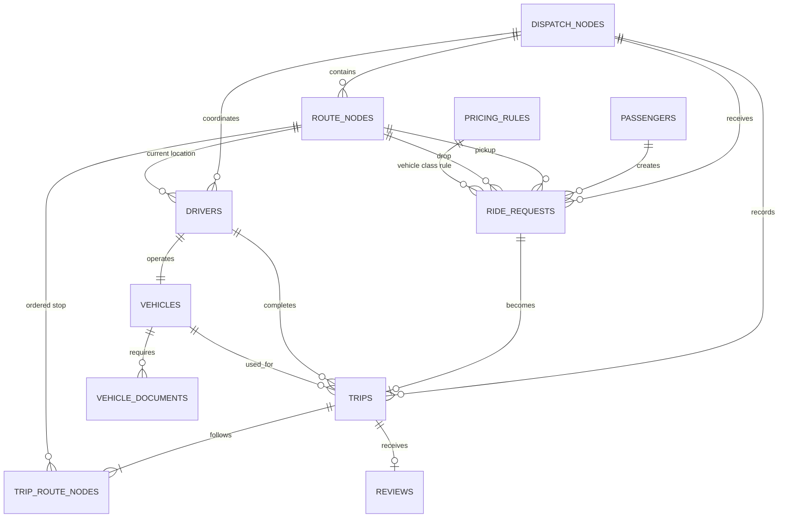

# ER model — Ride Registry

## Main relationship rules

- One dispatch node owns many route nodes, drivers, requests, and trip records.
- A passenger can create many ride requests. Each request has one pickup and one drop node.
- A driver is assigned one demo vehicle; a vehicle can have multiple document records.
- A request becomes at most one trip (`trips.request_id` is `UNIQUE`).
- A trip stores its ordered route through `trip_route_nodes` with composite key `(trip_id, sequence_no)`.
- A completed trip can receive at most one review (`reviews.trip_id` is `UNIQUE`).
- `v_driver_review_aggregates` computes driver averages; aggregate values are not duplicated in the driver table.

## Normalization note

The base entities are separated to keep driver details, vehicle details, document state, fare rules, route stops, and customer feedback in their own relations. The main relationships are keyed by primary/foreign keys rather than repeated names or free-text locations. Trip fare inputs and the final calculated fare are deliberately snapshotted into `trips` so an old trip remains auditable if the pricing rules later change.
